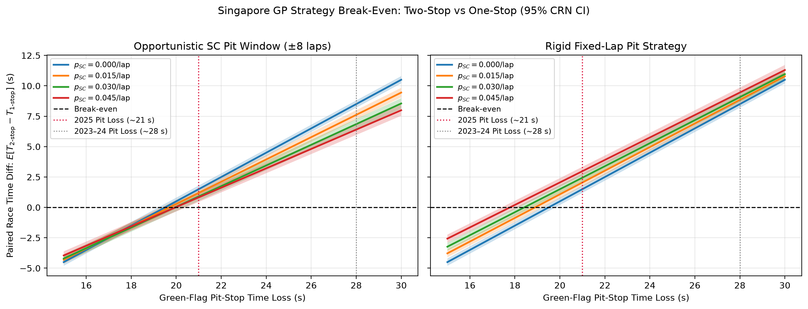
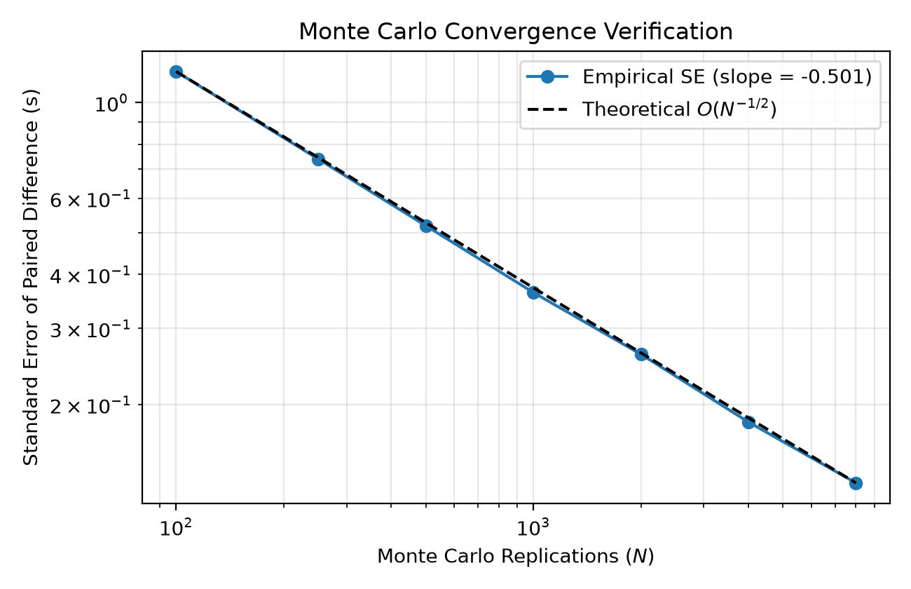

# Singapore GP Pit Strategy Sim

**When Does a Two-Stop Beat a One-Stop at the Singapore Grand Prix?**

A stochastic Monte Carlo and discrete-time Markov chain (DTMC) race-strategy simulator quantifying the break-even pit-stop time loss at Marina Bay Street Circuit.

- **Live Web Demo:** [https://helindus.github.io/singapore-gp-pit-strategy-sim/](https://helindus.github.io/singapore-gp-pit-strategy-sim/)
- [](https://colab.research.google.com/github/HelinduS/singapore-gp-pit-strategy-sim/blob/main/notebook/singapore-gp-pit-strategy-sim.ipynb)



## Overview & Question

At the Marina Bay Street Circuit, high pit-lane time loss historically locked teams into one-stop strategies. Raising the Singapore pit-lane speed limit in 2025 cut pit-stop loss from roughly 28 s to 21 s, yet one-stop strategies still dominated. At the same time, Safety Car deployments strongly discount pit-stop loss—and Marina Bay shifted from a 100% Safety Car streak (2008–2023) to zero Safety Cars in 2024 and 2025.

**Core Question:** How small must the green-flag pit-stop time loss be before a two-stop strategy outperforms a one-stop on expected 62-lap race time, and how do per-lap Safety Car probability and overtaking traffic shift that break-even threshold?

## Repository Structure

```text
singapore-gp-pit-strategy-sim/
├── data/                  # Clean 2023–2025 Singapore GP lap dataset (3,074 laps)
├── docs/                  # Standalone interactive web simulator (GitHub Pages)
├── figures/               # Publication plots (convergence, sweep, X3 traffic)
├── notebook/              # Full reproducible Jupyter notebook
├── scripts/               # CLI runner for calibration & sweeps
├── src/singapore_sim/     # Modular Python simulation, DTMC, OLS, & traffic package
├── pyproject.toml         # Package metadata
└── requirements.txt       # Python dependencies
```

## Quick Start

### Run Locally in VS Code / Jupyter
```bash
git clone https://github.com/HelinduS/singapore-gp-pit-strategy-sim.git
cd singapore-gp-pit-strategy-sim
python -m venv .venv
source .venv/bin/activate  # On Windows: .venv\Scripts\activate
pip install -r requirements.txt
python scripts/run_analysis.py --n-sims 4000
```

### Open the Interactive Web Demo
Open `docs/index.html` directly in any modern browser (Chrome, Edge, Firefox) or visit the [Live Web Demo](https://helindus.github.io/singapore-gp-pit-strategy-sim/).

## User Guide

See [USER_GUIDE.md](USER_GUIDE.md) for CLI commands, parameter definitions, interactive controls, and scenario presets.

## Model and Mathematics Summary

Lap time $T_t$ on lap $t \in \{1, \dots, 62\}$ with compound $c$ and zero-indexed tyre age $a_t$ is modeled as:

$$T_t = T_{\text{base}} + \gamma \cdot t + \Delta_c + \beta_c a_t + \varepsilon_t, \quad \varepsilon_t \sim \mathcal{N}(0, \sigma^2)$$

calibrated via driver-season-adjusted OLS on clean green-flag laps from the 2023–2025 Singapore Grands Prix. Race neutralization follows a two-state discrete-time Markov chain ($\text{Green} \leftrightarrow \text{Safety Car}$), discounting pit-stop loss by 50% under Safety Car conditions. Full derivations and verification proofs are documented in [THEORY.md](THEORY.md).

## Verification



The simulator is verified against five analytical and limiting benchmarks in the notebook:
1. **Deterministic Limit vs. Closed-Form Sum:** Setting $\sigma = 0$ and $p_{\text{SC}} = 0$ matches the exact arithmetic series total race time to machine precision ($< 10^{-9}$ s).
2. **Analytic Optimal Pit Lap vs. Grid Search:** Under symmetric linear degradation, grid search recovers the exact analytical optimum $p^* = N / 2 = 31$.
3. **DTMC Stationary Distribution:** Matrix power iteration $P^{500}$ and long-horizon simulations converge to $\pi_1 = p_{01} / (p_{01} + p_{10})$.
4. **CRN Variance Reduction & $N^{-1/2}$ Scaling:** Paired $(T_2 - T_1)$ variance is strictly lower than independent-seed variance, and standard error decays as $N^{-1/2}$.
5. **X3 Free-Air Limit:** Two-car traffic simulation with $\theta_{\text{overtake}} = 0.0\text{ s}$ matches the single-car CRN model to $< 10^{-12}\text{ s}$.

## Concepts Applied

This project applies empirical input modelling and ordinary least-squares parameter calibration, normal and uniform random variate generation, a two-state discrete-time Markov chain (DTMC) for race neutralization, and vectorized Monte Carlo integration with Common Random Numbers and Law of Large Numbers confidence intervals, verified against closed-form deterministic limits and stationary chain distributions.

## Results, Limitations & Future Work

- **Results:** Under zero-Safety-Car conditions ($p_{\text{SC}} = 0$), deterministic break-even is ~19.43 s, explaining why teams remained on one-stop plans even after the 2025 pit-lane speed limit increase (~21 s loss). Higher Safety Car probabilities shift the break-even threshold upward toward ~20.11 s, while Marina Bay overtaking traffic ($\theta = 1.2\text{–}2.0\text{ s/lap}$) adds ~1–3 s to the two-stop race time at 21 s pit loss.
- **Limitations:** The core model uses linear tyre wear without thermal cliffing, fixed 50% Safety Car pit-loss discounting, and a two-car overtaking threshold abstraction rather than a full 20-car field.
- **Future Work:** Extend the simulator to a full 20-car discrete-event field and Bayesian MCMC posterior sampling over tyre degradation rates.

## Key References

1. A. M. Law, *Simulation Modeling and Analysis*, 5th ed. McGraw-Hill, 2015.
2. FastF1 Python Library, Formula 1 Timing & Telemetry Data API (`https://docs.fastf1.dev/`).

Full bibliography with DOIs and links is available in [REFERENCES.md](REFERENCES.md).

## AI-Assistance Note

AI coding and writing assistants were used during development for scaffolding, code verification checks, and documentation structure; all equations, statistical fits, and numerical assertions were independently verified.

## Licence & Data Credits

- **Code Licence:** MIT License (see [LICENSE](LICENSE)).
- **Data Credits:** Historical Formula 1 session timing data accessed via the open-source FastF1 interface for non-commercial analytical research.
